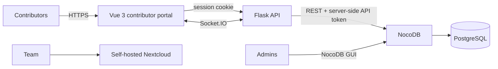

# Case study: a contributor platform for a charity auction

**Role:** Lead developer — sole engineer across the whole project · 2025–present
**Stack:** Vue 3, TypeScript, Flask, NocoDB, PostgreSQL, Socket.IO, Docker, Coolify, GitHub Actions
**Code:** private, at the client's request — details at the end

## The situation

Roll4Rights runs charity auctions. Contributors — people and businesses donating items
or experiences — had to get their listings to the team, get them approved, and then stay
in touch about details. That process lived in Google Drive and email. It worked, but it
put the burden on the client's small team: chasing contributors for photos, re-typing
item details into listings, and answering the same questions repeatedly.

The ask was a place where contributors could submit their own items, review how those
items would be listed, edit them after submitting, and communicate with the team — without
the team becoming a help desk.

I designed and built it alone, end to end: three custom applications plus the team's
self-hosted workspace, all deployed on infrastructure I run.

## How it works



- **Contributor portal** (Vue 3, TypeScript, Vite): registration, item submission,
  review and edit of submitted items, contributor-to-contributor chat over Socket.IO,
  direct messaging to the admin team, announcements and an event calendar, and FAQs.
- **Flask API**: the only path from the browser to the data. Holds the NocoDB credential
  server-side, enforces contributor and admin roles, and shapes what the browser receives.
- **NocoDB + PostgreSQL**: the admin console. The team reviews submissions there, generates
  listings, sends them to contributors for approval, and publishes announcements and
  calendar entries.
- **Nextcloud**: the team's workspace — video calls, internal chat, a private calendar,
  and shared files. Self-hosted so contributor material never sits in a third-party drive.

Registration is gated by an invitation code the client rotates between campaigns, so only
invited contributors get in. After that, each contributor has their own account and session.

## Three problems worth describing

### 1. The browser could see the database

**Symptom:** the first version had the portal calling NocoDB directly. That meant the
NocoDB API token and the table names had to live in client-side code, where anyone who
opened the browser's dev tools could read them. A token plus table names is enough to
query the database directly.

**Change:** I put a Flask API between the portal and NocoDB. The token moved into the
server's environment and never leaves it. The browser now talks only to Flask, which makes
the privileged call itself and returns only the shaped result.

```python
# Illustrative — a generic version of the pattern, not the client's code.

import os
import requests
from flask import Blueprint, jsonify

records = Blueprint("records", __name__)

DATA_API = os.environ["DATA_API_URL"]
DATA_API_TOKEN = os.environ["DATA_API_TOKEN"]  # never sent to the browser


@records.get("/api/records/<record_id>")
def get_record(record_id):
    upstream = requests.get(
        f"{DATA_API}/records/{record_id}",
        headers={"Authorization": f"Bearer {DATA_API_TOKEN}"},
        timeout=5,
    )
    upstream.raise_for_status()
    row = upstream.json()

    # The browser gets a shaped response, not the upstream record.
    return jsonify({"title": row["title"], "status": row["status"]})
```

The browser calls `/api/records/123`. It never learns the upstream URL, the token, or the
table structure behind it.

**Result:** the browser no longer receives credentials or schema. Anyone inspecting network
traffic sees requests to my API, not to the data layer.

**What I'd say about it now:** the original design wasn't wrong to reuse NocoDB — it was
wrong to let the client be the trusted party. The rule I took away is that any credential
the browser holds is a public credential.

### 2. Group video calls didn't work for more than two people

**Symptom:** Nextcloud Talk handled one-to-one calls but wouldn't hold a group call for
the team. The team is small — eight people — and the whole point of the workspace was to
stop paying for and coordinating around a separate video tool.

**Change:** I deployed Nextcloud Talk's high-performance backend as its own container, with
Redis for session state, and configured a TURN relay for participants whose networks block
direct peer connections.

**Result:** eight-person calls, reliably, across different networks and firewalls.

**What each piece does, briefly:** the default call mode is peer-to-peer, which works for
two participants and degrades quickly beyond that — the signaling backend coordinates the
connections instead. TURN exists for the cases where a direct connection can't be
established at all, usually corporate firewalls and symmetric NAT; media is relayed through
the server rather than failing.

### 3. Replacing a shared drive with an approval loop

**Symptom:** the old workflow had no state. An item was a folder, an approval was an email,
and nobody could tell which listings were final, which were waiting on the contributor, or
which had been changed after the fact.

**Change:** submissions now enter NocoDB as structured records. The team reviews them,
generates a listing, and sends it back to the contributor to approve or edit. Contributors
can revise their own items after approval; the team sees the current state in one place.

**Result:** the client stopped maintaining a shared drive, and the status of every
submission is visible without asking anyone.

**What I'd do next:** listing generation is still manual inside NocoDB. The obvious next
step is templating it so the team reviews a generated listing instead of assembling one.

## Infrastructure

The platform originally ran on Azure. I migrated it to a single Hetzner VPS running
Coolify, which brought total hosting — every service, plus backups — to about **$12/month**.
The migration was partly cost, partly a preference for managing the stack directly.

What that put on me: the reverse proxy, TLS certificates, container orchestration, and
backups for everything including Nextcloud and its Postgres and Redis instances. Four
repositories deploy through GitHub Actions. None of it is exotic, but it's the difference
between using a platform and operating one.

## Outcomes

- ~$50K raised across two campaigns the platform supported (bidding itself ran on Shopify)
- 100+ returning volunteers in the organization's first year, organization-wide
- Three custom applications and a self-hosted workspace, built and maintained by one engineer
- Hosting costs reduced to ~$12/month for all services and backups

## What I'd do differently

- **Per-person invitations instead of a shared code.** A rotating code is fine for a small
  nonprofit, but it can be forwarded. Individual invite links with expiry would be better.
- **Generate listings automatically.** It's the last manual step in an otherwise
  self-service workflow.
- **Build the API layer first.** I added Flask after the exposure problem appeared. It
  should have been the starting architecture.
- **Native auction flow.** Bidding currently happens on Shopify. A first-party auction
  experience is in progress, and it's the natural next chapter.

## About the code

The client's codebase is private and stays that way. This document describes the
architecture and the decisions, not the implementation — no client source, no contributor
data, no internal hostnames. I'm happy to walk through specific files or the deployment
setup in an interview.
